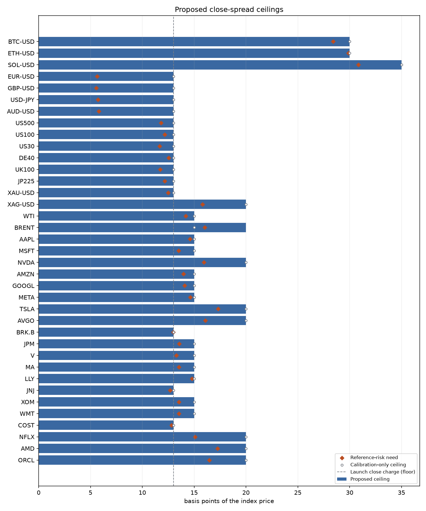

# Close-spread ceilings: results

37 of 37 launch markets have a proposed ceiling (0 blocked). By class, in basis points: crypto 30-35, fx 13, index 13, commodity 13-20, equity 13-20.
Nothing here is adopted: the burden limit, the floor and the tail statistic are the owner's to approve.

A ceiling is the most an operator may ever charge to close, not a forecast of price moves. A close is
charged a stress minimum plus a toxicity add-on only (no size spread on a pure close; liquidation waives
toxicity), which cover one risk: the index being stale or off the true price when a client closes. The
engine bounds that risk per market in its price rules, so the need is

`need = max_divergence_bps + hourly tail move * sqrt(max_age_ms / 1 hour)`

The ceiling is the smallest multiple of 5 bps at or above the need, never below 13 bps (the largest close charge the launch parameters allow, so no launch close is clamped). The tail move is the upper end of the weekly block-bootstrap interval of the calibration sample's hourly p99 of the in-bar move (the open against the previous close is left out). Hourly bars are scaled to the one-second quote age by square-root-of-time, an assumption no hourly data can test.

Gaps, closures and contract rolls are not in the need: a price jump is not a spread. They move margin and close-out risk, which `ceiling_effects.csv` shows a close spread cannot repair: in a 5% gap on EUR-USD, an uncapped 103-bp close charge cuts the zero-capital house shortfall by 22% to 35% while costing the trader 8 times as much.

## Per-market ceilings (basis points of the index price)

| Market | Class | Divergence | Hourly p99 (cal. upper) | Need | Calibration-only | Proposed | % of min margin | Validation hours over calibration-only | Confidence |
|---|---|---:|---:|---:|---:|---:|---:|---:|---|
| BTC-USD | crypto | 25 | 205 | 28.4 | 30 | **30** | 3.0% | 0.07% | moderate |
| ETH-USD | crypto | 25 | 294 | 29.9 | 30 | **30** | 3.0% | 0.30% | moderate |
| SOL-USD | crypto | 25 | 351 | 30.9 | 35 | **35** | 3.5% | 0.00% | moderate |
| EUR-USD | fx | 5 | 39 | 5.6 | 13 | **13** | 26.0% | 0.00% | moderate |
| GBP-USD | fx | 5 | 34 | 5.6 | 13 | **13** | 26.0% | 0.00% | moderate |
| USD-JPY | fx | 5 | 43 | 5.7 | 13 | **13** | 26.0% | 0.00% | moderate |
| AUD-USD | fx | 5 | 49 | 5.8 | 13 | **13** | 26.0% | 0.00% | moderate |
| US500 | index | 10 | 109 | 11.8 | 13 | **13** | 26.0% | 0.00% | moderate |
| US100 | index | 10 | 129 | 12.2 | 13 | **13** | 26.0% | 0.15% | moderate |
| US30 | index | 10 | 100 | 11.7 | 13 | **13** | 26.0% | 0.00% | moderate |
| DE40 | index | 10 | 152 | 12.5 | 13 | **13** | 26.0% | 0.09% | low |
| UK100 | index | 10 | 103 | 11.7 | 13 | **13** | 26.0% | 0.09% | low |
| JP225 | index | 10 | 130 | 12.2 | 13 | **13** | 26.0% | 0.19% | moderate |
| XAU-USD | commodity | 10 | 150 | 12.5 | 13 | **13** | 13.0% | 0.07% | moderate |
| XAG-USD | commodity | 10 | 349 | 15.8 | 20 | **20** | 20.0% | 0.00% | moderate |
| WTI | commodity | 10 | 251 | 14.2 | 15 | **15** | 15.0% | 0.60% | moderate |
| BRENT | commodity | 10 | 259 | 16.0 | 15 | **20** | 20.0% | 1.29% | moderate |
| AAPL | equity | 10 | 276 | 14.6 | 15 | **15** | 1.5% | 0.25% | moderate |
| MSFT | equity | 10 | 194 | 13.5 | 15 | **15** | 1.5% | 0.12% | moderate |
| NVDA | equity | 10 | 356 | 15.9 | 20 | **20** | 2.0% | 0.00% | moderate |
| AMZN | equity | 10 | 239 | 14.0 | 15 | **15** | 1.5% | 0.25% | moderate |
| GOOGL | equity | 10 | 241 | 14.1 | 15 | **15** | 1.5% | 0.12% | moderate |
| META | equity | 10 | 264 | 14.6 | 15 | **15** | 1.5% | 0.74% | moderate |
| TSLA | equity | 10 | 438 | 17.3 | 20 | **20** | 2.0% | 0.12% | moderate |
| AVGO | equity | 10 | 364 | 16.1 | 20 | **20** | 2.0% | 0.00% | moderate |
| BRK.B | equity | 10 | 180 | 13.0 | 13 | **13** | 1.3% | 0.25% | moderate |
| JPM | equity | 10 | 213 | 13.6 | 15 | **15** | 1.5% | 0.25% | moderate |
| V | equity | 10 | 197 | 13.3 | 15 | **15** | 1.5% | 0.12% | moderate |
| MA | equity | 10 | 213 | 13.5 | 15 | **15** | 1.5% | 0.00% | moderate |
| LLY | equity | 10 | 287 | 14.8 | 15 | **15** | 1.5% | 0.99% | moderate |
| JNJ | equity | 10 | 159 | 12.7 | 13 | **13** | 1.3% | 0.49% | moderate |
| XOM | equity | 10 | 212 | 13.5 | 15 | **15** | 1.5% | 0.00% | moderate |
| WMT | equity | 10 | 213 | 13.5 | 15 | **15** | 1.5% | 0.00% | moderate |
| COST | equity | 10 | 168 | 12.8 | 13 | **13** | 1.3% | 0.49% | moderate |
| NFLX | equity | 10 | 306 | 15.1 | 20 | **20** | 2.0% | 0.00% | moderate |
| AMD | equity | 10 | 436 | 17.3 | 20 | **20** | 2.0% | 0.25% | moderate |
| ORCL | equity | 10 | 388 | 16.5 | 20 | **20** | 2.0% | 0.37% | moderate |

Method and test: the method is fixed on the calibration sample (2024-10-28 to 2026-04-27) and tested on the later validation sample (to 2026-10-12). The calibration-only ceiling covers the validation need for 36 of 37 markets; BRENT did not, so the proposed value refits on the larger of the two tails (in-sample on the validation tail). Over the validation hours, the share whose need would exceed the calibration-only ceiling is at most 1.29%. The out-of-sample test could fail only for the 23 markets whose calibration-only ceiling is above the floor.

Burden: every proposed ceiling is at most 26% of the market's smallest initial margin (limit 30%). FX and index markets sit at the 13-bp floor, 26% of their 50-bp margin, so the launch parameters themselves already cost them that share of margin to close at the top stress level: an owner decision for the launch stress minimum, not for the ceiling.

Sensitivity: doubling the volatility input raises 33 ceilings, by at most 7 bps. The divergence limit in the genesis price rules, not volatility, sets most of each ceiling.

## What the choices cost

Registry against one global value: a single value must be at least 35 bps (the largest market), which costs 14 of 37 markets more than the burden limit, up to 70% of margin. At the strictest value (13 bps) 23 markets would need more than they may charge.

Reversal blending (grid of 6 position sizes and 4 opening fractions per market and stress level, against each market's proposed ceiling): the share of reversals whose blended spread exceeds the ceiling is 0.0% at calm, 1.9% at the elevated level and 16.4% at the top level (by class: commodity 7%, crypto 0%, equity 28%, fx 0%, index 4%). This is a grid, not a flow distribution. Under one global value at the floor instead, the shares are 0.0%, 4.5% and 24.5%.

Rounding: see `rounding` in `ceilings.json`. At an index of 0.65 units one raw unit is 0.000015 bp; a seeded search of 20,000 pure closes found at most 1 raw unit above the exact bound. A floor to the exact bound makes a close free only below 770 raw units.

## Evidence and limits

- Data: the 102-week hourly grid inherited from the exposure-cap study, a transformed proxy with selected gaps removed. See [the source audit](../source-audit.md) for providers, dates, time zones, checksums, licensing and what is missing.
- Nothing measures execution-horizon staleness or source divergence; the genesis limits stand in for it. That is why every confidence is at most moderate and DE40 and UK100 (cash-index proxies) are low.
- Calm and stressed periods are both in the grid, but unseen tails, venue outages and proxy errors are not covered, and no historical calibration guarantees future outcomes.
- The sweep conditions on two existing isolated positions and one price jump; it is not a cross-margin or admission simulation, and scenario counts are not probabilities.
- Engine agreement: 13 vectors compare the pricing model with `Engine::apply` fills at V17 and V21 (`cargo test -p engine-core --test close_spread_calibration`).
