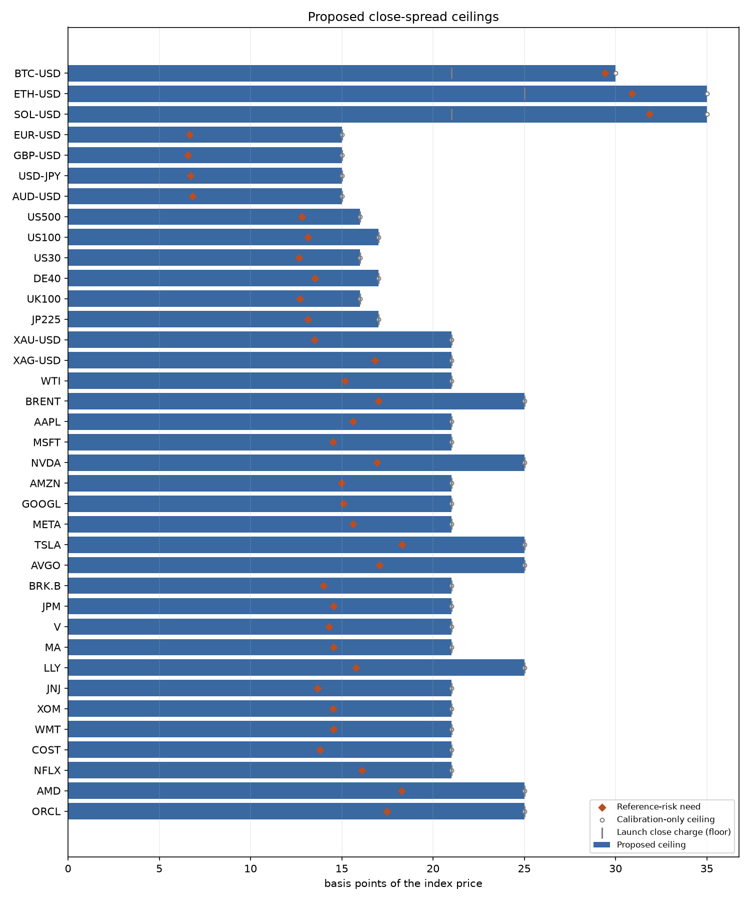

# Close-spread ceilings: results

34 of 34 launch markets have a proposed ceiling (0 blocked). By class, in basis points: crypto 30-35, fx 17, index 18-19, commodity 23, equity 23-27.
Nothing here is adopted: the burden limit, the floor and the tail statistic are the owner's to approve.

A ceiling is the most an operator may ever charge to close, not a forecast of price moves. From V52 a
close is charged a stress minimum, a toxicity add-on (waived on a liquidation) and the size spread on the
slice it closes. The minimum and add-on cover one risk: the index being stale or off the true price when a
client closes. The engine bounds that risk per market in its price rules, so the need is

`need = (max_divergence_bps + 1) + hourly tail move * sqrt(max_age_ms / 1 hour)`

The ceiling is the smallest multiple of 5 bps at or above the need, never below the market's launch close charge: the 15-bp widest stress minimum and top toxicity add-on, plus the market's first spread band at the widest size multiplier, in tenths of a bp rounded up to a whole bp (17 to 27 bps). From V52 the engine refuses a ceiling below it, and on a first-band close at the launch parameters the clamp removes at most what the engine's upward rounding adds. The tail move is the upper end of the weekly block-bootstrap interval of the calibration sample's hourly p99 of the in-bar move (the open against the previous close is left out). Hourly bars are scaled to the one-second quote age by square-root-of-time, an assumption no hourly data can test.

Gaps, closures and contract rolls are not in the need: a price jump is not a spread. They move margin and close-out risk, which `ceiling_effects.csv` shows a close spread cannot repair: in a 5% gap on EUR-USD, an uncapped 103-bp close charge cuts the zero-capital house shortfall by 22% to 35% while costing the trader 6 times as much.

## Per-market ceilings (basis points of the index price)

| Market | Class | Divergence | Hourly p99 (cal. upper) | Need | Calibration-only | Proposed | % of min margin | Validation hours over calibration-only | Confidence |
|---|---|---:|---:|---:|---:|---:|---:|---:|---|
| BTC-USD | crypto | 25 | 205 | 29.4 | 30 | **30** | 30.0% | 0.20% | moderate |
| ETH-USD | crypto | 25 | 294 | 30.9 | 35 | **35** | 35.0% | 0.07% | moderate |
| SOL-USD | crypto | 25 | 351 | 31.9 | 35 | **35** | 3.5% | 0.02% | moderate |
| EUR-USD | fx | 5 | 39 | 6.6 | 17 | **17** | 34.0% | 0.00% | moderate |
| GBP-USD | fx | 5 | 34 | 6.6 | 17 | **17** | 34.0% | 0.00% | moderate |
| USD-JPY | fx | 5 | 43 | 6.7 | 17 | **17** | 34.0% | 0.00% | moderate |
| AUD-USD | fx | 5 | 49 | 6.8 | 17 | **17** | 34.0% | 0.00% | moderate |
| US500 | index | 10 | 109 | 12.8 | 18 | **18** | 36.0% | 0.00% | moderate |
| US100 | index | 10 | 129 | 13.2 | 19 | **19** | 38.0% | 0.00% | moderate |
| US30 | index | 10 | 100 | 12.7 | 18 | **18** | 36.0% | 0.00% | moderate |
| JP225 | index | 10 | 130 | 13.2 | 19 | **19** | 38.0% | 0.00% | moderate |
| XAU-USD | commodity | 10 | 150 | 13.5 | 23 | **23** | 23.0% | 0.00% | moderate |
| XAG-USD | commodity | 10 | 349 | 16.8 | 23 | **23** | 23.0% | 0.00% | moderate |
| WTI | commodity | 10 | 251 | 15.2 | 23 | **23** | 23.0% | 0.00% | moderate |
| AAPL | equity | 10 | 276 | 15.6 | 23 | **23** | 2.3% | 0.00% | moderate |
| MSFT | equity | 10 | 194 | 14.5 | 23 | **23** | 2.3% | 0.00% | moderate |
| NVDA | equity | 10 | 356 | 16.9 | 27 | **27** | 2.7% | 0.15% | moderate |
| AMZN | equity | 10 | 239 | 15.0 | 23 | **23** | 2.3% | 0.00% | moderate |
| GOOGL | equity | 10 | 241 | 15.1 | 23 | **23** | 2.3% | 0.00% | moderate |
| META | equity | 10 | 264 | 15.6 | 23 | **23** | 2.3% | 0.00% | moderate |
| TSLA | equity | 10 | 438 | 18.3 | 27 | **27** | 2.7% | 0.00% | moderate |
| AVGO | equity | 10 | 364 | 17.1 | 27 | **27** | 2.7% | 0.00% | moderate |
| BRK.B | equity | 10 | 180 | 14.0 | 23 | **23** | 2.3% | 0.00% | moderate |
| JPM | equity | 10 | 213 | 14.6 | 23 | **23** | 2.3% | 0.00% | moderate |
| V | equity | 10 | 197 | 14.3 | 23 | **23** | 2.3% | 0.00% | moderate |
| MA | equity | 10 | 213 | 14.5 | 23 | **23** | 2.3% | 0.00% | moderate |
| LLY | equity | 10 | 287 | 15.8 | 27 | **27** | 2.7% | 0.00% | moderate |
| JNJ | equity | 10 | 159 | 13.7 | 23 | **23** | 2.3% | 0.00% | moderate |
| XOM | equity | 10 | 212 | 14.5 | 23 | **23** | 2.3% | 0.00% | moderate |
| WMT | equity | 10 | 213 | 14.5 | 23 | **23** | 2.3% | 0.00% | moderate |
| COST | equity | 10 | 168 | 13.8 | 23 | **23** | 2.3% | 0.00% | moderate |
| NFLX | equity | 10 | 306 | 16.1 | 23 | **23** | 2.3% | 0.00% | moderate |
| AMD | equity | 10 | 436 | 18.3 | 27 | **27** | 2.7% | 0.00% | moderate |
| ORCL | equity | 10 | 388 | 17.5 | 27 | **27** | 2.7% | 0.00% | moderate |

Method and test: the method is fixed on the calibration sample (2024-10-28 to 2026-04-27) and tested on the later validation sample (to 2026-10-12). It covers every market, so the proposed value refits on the larger of the two tails (in-sample on the validation tail). Over the validation hours, the share whose need would exceed the calibration-only ceiling is at most 0.20%. A market at its floor fails the test whenever its validation need exceeds its launch charge, so the count of markets whose calibration-only ceiling is above its floor (3) is not the population that can fail it.

Burden: every proposed ceiling is at most 38% of the market's smallest initial margin (limit 30%). Floor-bound ceilings (EUR-USD, GBP-USD, USD-JPY, AUD-USD, US500, US100, US30, JP225, XAU-USD, XAG-USD, WTI, AAPL, MSFT, NVDA, AMZN, GOOGL, META, TSLA, AVGO, BRK.B, JPM, V, MA, LLY, JNJ, XOM, WMT, COST, NFLX, AMD, ORCL) sit at their markets' launch close charges, at most 38% of the smallest initial margin, so the launch parameters themselves already cost them that share of margin to close a first-band position at the top stress level: an owner decision for the launch stress minimum and spread bands, not for the ceiling.

Sensitivity: doubling the volatility input raises 3 ceilings, by at most 5 bps. The divergence limit in the genesis price rules, not volatility, sets most of each ceiling.

## What the choices cost

Registry against one global value: a single value must be at least 35 bps (the largest market), which costs 13 of 34 markets more than the burden limit, up to 70% of margin. At the strictest value (17 bps) 30 markets would need more than they may charge.

Reversal blending (grid of 6 position sizes and 4 opening fractions per market and stress level, priced as V52 prices them, closing slice included, against each market's proposed ceiling): the share of reversals whose blended spread exceeds the ceiling, which the engine refuses, is 0.0% at calm, 0.7% at the elevated level and 34.8% at the top level (by class: commodity 21%, crypto 7%, equity 54%, fx 0%, index 4%). A pure close of the same positions pays more than its ceiling, which clamps it, in 0.0%, 0.0% and 31.4% of positions: the floor covers a first-band close, and a larger one reaches higher bands. This is a grid, not a flow distribution. With every ceiling at its market's floor instead, the reversal shares are 0.0%, 0.7% and 37.0%.

Rounding: see `rounding` in `ceilings.json`. At an index of 0.65 units one raw unit is 0.000015 bp; a seeded search of 20,000 pure closes found at most 1 raw unit above the exact bound. A floor to the exact bound makes a close free only below 589 raw units at the strictest ceiling (17 bps).

## Evidence and limits

- Data: the 102-week hourly grid inherited from the exposure-cap study, a transformed proxy with selected gaps removed. See [the source audit](../source-audit.md) for providers, dates, time zones, checksums, licensing and what is missing.
- Nothing measures execution-horizon staleness or source divergence; the genesis limits stand in for it. That is why every confidence is at most moderate and DE40 and UK100 (cash-index proxies) are low.
- Calm and stressed periods are both in the grid, but unseen tails, venue outages and proxy errors are not covered, and no historical calibration guarantees future outcomes.
- The sweep conditions on two existing isolated positions and one price jump; it is not a cross-margin or admission simulation, and scenario counts are not probabilities.
- Engine agreement: 13 vectors compare the V17 pricing model with `Engine::apply` fills at V17 and V21, and 26 compare the V52 model at V52 (`cargo test -p engine-core --test close_spread_calibration`).
