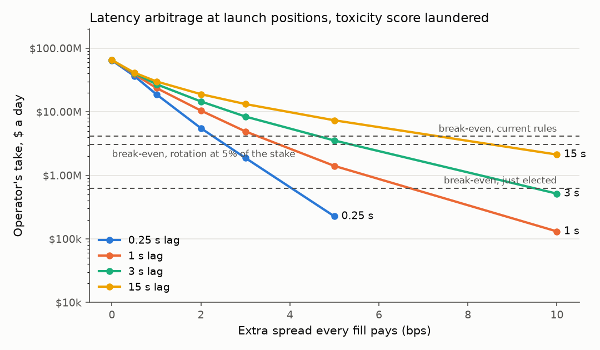
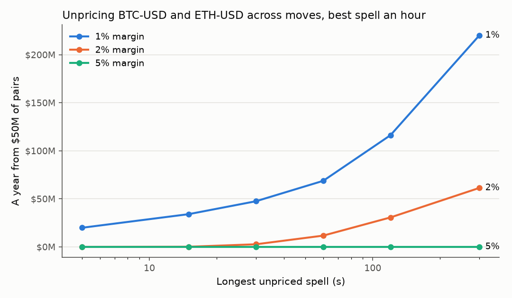

# Rogue operator

What can the operator take by delaying prices, holding a sync, reordering and censoring requests,
and unpricing markets, when it plays by every rule the enclave enforces? And is that less than it
risks? (#549)

## Summary

The bounds built into the image do not make extraction unprofitable for a rogue operator at
production values. They make most of it visible, and only for someone comparing the public log
with the venues' own prices. Measured on a year of Coinbase trades sampled by volatility, with the
client flow of #111 and #134 and Secure TSC on, each attack takes:

| Attack | Taken a day, launch flow | At 10x flow | Operator's take a day, launch | What limits it |
|---|---|---|---|---|
| Latency arbitrage, toxicity score laundered | $81.2M ($74.8M to $88.2M) | the same | $65.0M | the exposure cap alone |
| Latency arbitrage, if the toxicity add-on were paid | $10.5M ($9.1M to $12.1M) | the same | $8.4M | the 3 s lag and the add-on |
| Skimming client fills | $796k ($722k to $878k) | $5.94M ($5.41M to $6.52M) | $159k | the 3 s lag |
| Censoring closes 10 s, over skimming them at arrival | -$18k (-$46k to $10k) | not measured | — | no momentum detected |
| Held sync's kill option, four restarts a day | $2k | the same | $2k | the 5 s alert |
| Unpricing across moves, $50M of pairs | $156k (-$3k to $431k); $35M on 2025-10-10 | the same | $125k | the 1% margin; not the spell's length |
| Altering Databento quotes, every RWA fill | up to $1.80M | up to $18.0M | $360k | the divergence bound |
| Choosing the venue, if `min_sources` were 1 | $806k | $8.06M | $161k | the venues' half-gap |
| All the crypto attacks together, score laundered | | | $65.2M ($60.0M to $71.1M) | |
| All the crypto attacks together, add-on paid | | | $8.7M ($7.4M to $10.2M) | |

The 95% intervals are a stratified bootstrap of the sampled hours. Each row is a rate: the house
holds $107M at #134's liquidity floor, so at the laundered rate it is empty in about a day and a
half, and past that the operator's balances are claims on clients' deposits in the vault. The
combined rows are the
operator's take from its own latency arbitrage, held syncs and pairs on the three crypto markets
plus its share of skimming every client fill there, at once. Against this, the operator's
20% of distributions is worth $169k a day at launch flow, $61.7M a year, and ten times that at
10x. The attacks the operator's own accounts run cost the house; skimming, censoring and altered
quotes cost clients and pay the house, so the operator receives only its 20% of them.

- **The price-age bound does not limit latency arbitrage.** BTC-USD, ETH-USD and SOL-USD fill at no
  spread below $2M (BTC-USD) or $1M of an account's position. With no spread every move the operator
  can see coming pays, so any lead longer than its decision interval collects the index's whole
  variation: a quarter-second lag takes $80.4M a day, the full 3 s $81.2M. The toxicity add-on
  would price the lead, but a round trip at the zero tier costs nothing and pulls the score back
  under its first tier, which `crates/core/tests/rogue_operator.rs` shows through `Engine::apply`.
  Only the exposure cap bounds it, through the utilisation trigger: at launch that is $6.9M a market,
  and at #134's retained NAV the same attack takes $162M a day. It is not stealthy: about 150,000
  positions a day, 84% of them winners on BTC-USD.
- **Nothing bounds how long a market stays unpriced, and no cap limits a pair.** An operator holding
  pairs, long in one account and short in another, unprices a market across a fast move, and the
  losing leg's loss past its 1% margin becomes the house's bad debt. A simple rule on $50M of pairs
  nets $57M a year (-$1.3M to $157M) and about $35M across four hours of 2025-10-10; the pairs, and
  the take, grow with the operator's capital. This is the study's least robust figure: holding the
  index where the venues diverge, as the engine would, moves it to $159M (-$9.8M to $482M). At 2% margin every rule tried loses money over the
  year, and the best of them makes $0.3M on that day.
- **Skimming costs clients 0.45 bps of what they fill** ($796k a day at launch flow; 0.34 bps and
  $5.9M at 10x), each fill priced at the worst index of its last 3 s. The operator's 20% roughly
  doubles its honest income. A monitor that rebuilds the index from venue data and compares fills
  with it would catch it nine times in ten within a few hundred fills on average, minutes of launch
  flow, allowing for an honest node's fills scattering half a basis point; without a monitor,
  nothing shows it.
- **Censoring beyond the lag shows no gain.** After a fast minute, the next 5 s to 5 minutes show
  no momentum in the year's sample: every interval includes zero, though the widest span several
  bps either way, so a small edge is not ruled out. Holding closes 10 s and then taking the worst
  index of the last 3 s takes $18k a day less (-$46k to $10k) than taking each close's worst index
  at arrival.
- **The held sync's kill option is worth little.** A hold no longer than the lag never needs a
  kill; at 5 s a kill avoids 0.13 bps a use against keeping the same trade, about $2k a day on
  BTC-USD at four restarts.
- **Removal comes too late for an exit.** If stakers act the day an attack starts, an operator past
  its minimum term keeps operating about 15 days, so any attack taking over $4.1M an operating day
  pays; one inside its 90-day minimum term, over $630k. Under daily rotation a member with 5% of the
  stake has a seat worth $3.1M a year and a whole day to itself, so one day of anything over $3.1M
  pays. Only the guardian, which can retire the signer at once (the node then stops serving, and the
  standby the liveness rule promotes three days later resumes at the last checkpoint the retired key
  signed), stops an exit inside hours: at six hours the break-even is $247M a day, at the cost of
  three days of every client's commands.

Where extraction stops paying, against the break-even of each removal route, and whether production
values meet it:

| Attack | Stops paying when | Production | Meets it |
|---|---|---|---|
| Latency arbitrage | the operator's take an operating day is below the route's break-even: under the current rules ($4.1M) the add-on must be paid and the lag at most 1 s with 1 bp of extra spread ($2.8M), or 5 bps of extra spread at 3 s ($3.5M); inside the minimum term ($630k) or for a 1% rotation member ($617k), at most a 0.5 s lag with the add-on and 3 bps more | laundered score, no spread, 3 s | no |
| Unpricing pairs | margin of 2% or more on BTC-USD and ETH-USD, so a pair needs a 2.2% move inside one spell | 1% to $2M | no |
| Skimming, altered quotes | a monitor detects them: their take is below every break-even if acted on at once, and pays for ever if not | no monitor | no |
| Held sync, censoring | already below every break-even | 5 s; 5-minute expiry | yes |

## The question

The operator runs the enclave's host. It cannot change the engine's rules, sign a state they do not
produce, or act for an account without its key. But the host carries every byte in and out of the
enclave, sets the wall clock within a bound, owns the disk, and can stall or restart the process.
Within the bounds the image enforces, it can delay prices, hold a batch's sync, delay or drop other
traders' requests, and choose the order in which requests arrive. None of this writes anything false
to the public log, so no successor, standby or vault check can prove it happened, and what it gains
arrives as ordinary trades.

This study measures, for each such attack and for the best combination, how much value it moves per
day and per year at launch flow and at ten times launch flow, and compares that with what the operator
puts at risk: its 20% share of distributions, its self-bond, and how long stakers take to remove it,
under the current election rules and under daily rotation. It then finds the parameter values at which
extraction stops paying, and whether the production values meet them.

## Attacker model

**Who.** The operator in effect. It runs the host, holds the admin key, and trades through any
number of accounts the engine cannot link to it. It is rational: it attacks when the expected gain
exceeds what it expects to lose.

**What it controls.**

- *The network.* TLS stops it reading or altering venue frames, client requests and replies, but not
  delaying or dropping them. For a client request it sees the timing, size and source of the
  encrypted bytes, not the content: TLS ends inside the enclave.
- *The disk.* It reads each command as the sequencer writes it to the public log, before the batch is
  durable and before any reply or stream entry goes out.
- *The clock*, within `time.max_drift` of signed Roughtime readings.
- *The process.* It can stall the sync or the CPU, and kill the node and restart it from host disk.

**What bounds it, as built** (production values; Secure TSC on, #542):

| Lever | Bound | Where |
|---|---|---|
| Price lag | A fill's price is at most `max_delay + max_age_ms` = 2 s + 1 s = 3 s old from the venue's send | #510, PR #538, `crates/node/src/feeds/venue/` |
| Quiet venue | A stalled book's leg holds at most 5 s more while its pings answer; the host cannot fake a stall, since a pong arrives only behind every frame sent before it | #521 |
| Held sync | A Critical alert, and stamping stops, once the oldest unsynced batch is held past 5 s | #541 |
| Request delay | A client request's own expiry, at most 5 minutes ahead (`MAX_EXPIRY_AHEAD_MS`) | `crates/core/src/auth.rs` |
| Unpriced spell | None: a market whose venue is held back past `max_delay` simply has no price | |
| Databento quotes | Unauthenticated: alterable in flight within `max_divergence_bps` of the TLS source | SECURITY.md |
| Rolling back the log | Detected and provable: on-chain log heads and the standby's signed copy | #541, #547 |

**Defences inside the engine** (`config/production-genesis.toml`): a spread made of the stress
level's minimum (0, 2 or 10 bps), the account's toxicity add-on (2 bps from a 1 bp score, 3 bps from
2 bps) and a size spread on the slice of an account's position past the first tier (BTC-USD's first
tier is 0 bps to $2M); close-spread ceilings; a 10% profit fee on realised gains; the house's
exposure caps, which an order that grows the house's net exposure past them cannot fill, and the
utilisation trigger at 70% of a cap; the divergence bound and the stress triggers (75 and 200 bps
moves in a minute; 60.01% and 95% of the divergence bound; 70% and 95% utilisation).

**Defences outside it.** Removal by election (14-day epochs, a 90-day minimum term, 7 days' notice
plus a 1-day finality margin; #359, #360), or by daily rotation once it is built (#551); the
operator's 20% of distributions (V47, #434), which removal ends; the self-bond, 0.1% of MONKEY's
maximum supply, locked but never slashed (#359 §11, #360); the guardian, which can pause withdrawals
and retire the signer at once; and the timelock (3 days).

**Without Secure TSC.** Every time bound above rests on the guest's monotonic clock. A host that
scales it stretches all of them, so the price lag and the held sync have no bound. The sweeps below
run the lag to 15 s and the hold to 30 s to show what that is worth.

## The attacks

| Attack | What the operator does | Who pays | What limits it | What does not |
|---|---|---|---|---|
| Latency arbitrage | Trades its own accounts against the index it holds up to 3 s behind the venues | The house | The exposure cap, through the utilisation trigger; the fast-move trigger's 2 bps; the toxicity add-on, if the account pays it; the profit fee | The lag bound: at a zero spread any lead longer than the operator's decision interval collects the index's whole variation. Round trips at the zero tier cost nothing and pull the toxicity score back down, so the add-on is never paid |
| Front-running by reordering | Puts its own orders ahead of others' | — | Requests are encrypted to the enclave, so the host sees only timing and size; fills are at the index, so no client order moves the price; size spreads read each account's own position | Cap room is first come: an order the operator puts first can take the room a client's needed, and push a market over the utilisation trigger so the client pays 2 bps |
| Skimming | Fills each client order at the worst index in the last 3 s (reordering plus the lag) | Clients, to the house | The lag | Each fill looks like latency; only the aggregate shows |
| Free option on a held sync | Trades, holds the sync up to 5 s, and kills the node if the trade lost | The house | The 5 s alert; every client sees replies stall, and each kill is a restart | Nothing records a kill in the log |
| Censoring closes, stops and deposits | Delays others' closes and deposits while the market moves against them; gaps the index through their stops | Clients, to the house | The lag: beyond what it can see, a delay is a bet; the request's expiry; latency every client sees | — |
| Unpricing | Holds one venue back past `max_delay` across a fast move, so its paired positions skip their close-out | The house, as bad debt | The margin: a pair pays only past about `margin / 0.9`, 1.1% at 100x; the profit fee | How long a market stays unpriced; caps, since a pair adds no net exposure |
| Choosing the venue (`min_sources = 1`) | Holds one venue back so the index is the other | Clients, to the house | Half the venues' gap | The divergence check, which needs two sources |
| Altering Databento quotes | Moves the index within the divergence bound on markets priced from Databento and one TLS source | Clients or the house | `max_divergence_bps`, and the level-1 divergence trigger | — |
| Rolling back the log | Cuts answered commands from the log | — | Provable: on-chain log heads (#541) and the standby (#547) | Out of scope: it leaves signed evidence |

## Data

**A year of venue trades, sampled by volatility.** The three markets measured are BTC-USD, ETH-USD and
SOL-USD, 77% of launch flow, priced from Coinbase and Kraken. `fetch/history.py candles` pulls
Coinbase Exchange's hourly candles for each from 2025-11-01 to 2026-11-01 (8,755 of the year's 8,760
hours; Coinbase has none for the other five). `derive/sample.py` ranks each market's hours by their
Parkinson volatility, `ln(high / low) / sqrt(4 ln 2)`, splits them into five strata (the quietest
50%, then 50–80%, 80–95%, 95–99% and the top 1%) and draws 10, 10, 10, 10 and 12 hours from them at
seed 549: 52 hours a market, the busiest ones sampled 40 times as densely as the quietest.
`fetch/history.py trades` then pulls every Coinbase Exchange trade in each sampled hour, from three
minutes before it to two after, paging back by trade id, and every Kraken trade, paging forward by
time. Both are public endpoints that need no key. The pull checks each trade for a positive finite
price and size and a time inside the window, and each page for ordered ids or times, and retries or
stops rather than writing a partial hour.

**A stress day.** 2025-10-10, the largest crypto liquidation day on record, falls a month before the
year. Its four most volatile hours on each market are pulled the same way and reported apart: they
never enter a year's estimate.

**The index proxy.** The engine prices these markets from the midpoint of Coinbase's and Kraken's
book mids. Public history has trades, not books, so the model's index is Coinbase's last trade on a
50 ms grid (`derive/grids.py`). Coinbase prints several trades a second on these pairs and its
spread is a cent; Kraken trades a tenth as often, so its last trade lags its book, and the Kraken
grid is kept only for checks. `derive/grids.py` stores the grids delta-encoded in
`data/derived/grids.npz` (3 MB), with each hour's trade count, longest gap between trades and the
SHA-256 of the raw file it came from in `grids.json`.

**A live recording.** To see how far the proxy is from the engine's real index,
`fetch/record_books.py` recorded both venues' top of book and trades on the three pairs on
2026-11-04 (Coinbase's `level2` and `market_trades` channels, Kraken's `book` at depth 10 and
`trade`, as the node's adapters subscribe), one whole UTC hour in all. `derive/calibrate.py`
compares the two-venue book-mid index with the Coinbase trade proxy over each whole hour: their
moves over each horizon, their variation at 250 ms, the worst index a 3 s look-back offers, the
venues' half-gap, and the share of time the venues diverge past the divergence triggers
(`results/calibration.json`).

**Client flow.** The flow #111 and #134 model (`research/cap-calibration`): a steady $182M of margin
opened a day, each market's share of the #111 market mix, each position at the market's maximum
leverage under its margin bands, and the fill-size distribution of that study's size profile
(`model/flow.py`). At launch flow that is $12.0B of BTC-USD fills a day (1.5 a second, $90k on
average), $5.4B of ETH-USD and $0.18B of SOL-USD; "10x" multiplies the margin by ten.

**The house's honest income.** #134's baseline: at the recommended $107M liquidity floor, under the
planned crypto margin bands, the house distributes a mean of $76.1M over 90 days at launch flow,
$845k a day, so the operator's 20% is $169k a day, $61.7M a year. The study scales it tenfold at 10x;
#134's own flow sensitivities move only the markets it clones, so they cannot test that.

## Method

Every attack runs on every sampled hour (`model/hourly.py`), in one of three units: per dollar of the
operator's own position, per dollar a side of its paired positions, or in dollars at the modelled
client flow. `run.py simulate` spreads the hours over three workers; it is deterministic (each hour's
client arrivals are seeded by the hour).

**Latency arbitrage** (`model/latency.py`). Holding the index `lag` behind the venues means the
operator always knows the engine's next `lag` seconds of index. Every 250 ms it chooses a position
of `-1`, `0` or `+1` units by a receding-horizon dynamic programme over the index it knows, given
the spread each fill pays: the stress level's minimum from the fast-move trigger, replayed on the
hour (`model/stress.py`), any extra spread in the sweep, and 3 bps if the account pays the top
toxicity tier. Each position then pays the profit fee on a positive result. The size is 69% of the
market's cap, so the utilisation trigger (70%) never fires: $6.9M a market at launch, under the $10M
floor #134 records as #111's outcome, and $22.2M, $14.8M and $7.4M at #134's retained NAV. One
account per $2M keeps every fill in BTC-USD's zero size tier.

**Skimming and censoring** (`model/skim.py`). Client fills arrive as a Poisson process at the flow
rate, each a buy or a sell with even odds and a size from the flow model. An order arriving at `a`
can fill at the index of any moment from `a - lag` to `a + delay`, and the operator picks the worst
for the client. Three measures, in the house's gain against the index at arrival: `bound`, every
order its own worst moment (an upper bound, since one index path serves them all); `sequenced`,
orders in arrival order on a forward-only index, by an exact dynamic programme over the moments
(achievable; reordering clients could do better); and `causal`, for a delay longer than the lag,
where the operator waits the whole delay and takes the worst of the last `lag`, since it cannot
know the window's worst moment until it has passed.

**The held sync** (`model/hold.py`). Every 10 s the operator opens a position at the stale index in
the direction the venues have already moved, then holds the sync for `hold` seconds. If the best
close it can then show loses, it kills the node and the trade never happened; otherwise it commits.
The kill option's value is the loss it avoids against keeping the same trade; the table also
gives closing at once, without the hold. Each kill is a restart every client sees.

**Unpricing** (`model/unprice.py`). The operator holds pairs: long in one account, short the same
notional in another, at the margin floor. Per dollar a side, a repricing after a move `J` pays
`0.9 (J - s) - min(J + s, m)`, where `m` is the margin rate and `s` the stress minimum both closes pay
once the move reads as fast; `crates/core/tests/rogue_operator.rs` checks it through
`Engine::apply` with no stress spread (`s = 0`) on the `V21` harness, the latest without access
screening. Two rules: `best`, the hour's single best spell of at most `spell` seconds, chosen in
hindsight; and `causal`, which unprices once the venues have moved `trigger` in 5 s, counts the move
from the engine's last index 3 s earlier, and prices again as soon as the pair pays 0.3% past
break-even or at the spell's end. The pairs are $50M a side: $1M of margin a side at 1%.

**Momentum** (`model/hourly.py`). Censoring a request longer than the lag only pays if moves continue.
For each second whose trailing minute moved at least 25, 50 or 100 bps, the next 5, 30, 60 and 300 s
move in the same direction is recorded.

**A year's estimate** (`model/stats.py`). A measure's year total is `sum over strata of N_k * mean_k`,
`N_k` the stratum's hours, scaled from 8,755 to 8,760 hours; a day is a year over 365. Its 95%
interval is a stratified bootstrap of the hours (10,000 draws). A rate per fill is a ratio of two
year totals, bootstrapped together.

**What the operator risks** (`model/economics.py`). An attack on the house through the operator's own
accounts costs it its share of what it takes: it keeps `0.8 (1 - stake)`, `stake` being its share of
staked MONKEY (0 here). An attack on clients pays the house, of which the operator gets `0.2 + 0.8
stake`. Removal is measured in days the operator keeps operating once stakers act: under the current
rules, the next election close (7 days on average) plus the 8-day notice, or up to 98 days for an
operator still inside its 90-day minimum term; under daily rotation, the 8-day notice at the
operator's share of days; through the timelock, 3 days. Removal forfeits the seat: the operator's
future share, valued here at one year of it. The attack pays, even if stakers act the day it starts,
when its take per operating day exceeds the seat divided by the operating days before removal. The
self-bond is never slashed, so it enters only through what MONKEY's price loses.

## Results

`results/report.md` holds every table; the figures below are from it. A day is a year over 365.

### Latency arbitrage

At the launch positions ($6.9M a market), the operator's own accounts take from the house, a day:

| Lag | No extra spread | +1 bp | +2 bps | +3 bps | +5 bps | +10 bps |
|---|---|---|---|---|---|---|
| 0.25 s, laundered | $80.4M | $23.5M | $6.9M | $2.3M | $282k | 0 |
| 1 s, laundered | $81.0M | $29.6M | $13.1M | $6.1M | $1.8M | $164k |
| 3 s, laundered | $81.2M | $33.9M | $18.2M | $10.5M | $4.4M | $643k |
| 15 s, laundered | $81.2M | $37.5M | $23.7M | $16.5M | $9.2M | $2.7M |
| 0.25 s, add-on paid | $2.3M | $856k | $282k | $158k | $9k | 0 |
| 1 s, add-on paid | $6.1M | $3.5M | $1.8M | $1.2M | $719k | 0 |
| 3 s, add-on paid | $10.5M | $6.6M | $4.4M | $2.8M | $1.5M | $95k |
| 15 s, add-on paid | $16.5M | $12.1M | $9.2M | $7.0M | $4.0M | $1.5M |

A zero is a small negative estimate: the policy chooses without the profit fee, so where almost
nothing pays it can lose a little, and an operator would not trade.



With no spread the lag does not matter: the operator profits from every move it sees before the
engine does, and seeing one decision interval ahead is enough. Each basis point of spread every fill
pays cuts the take sharply, and the lag then decides how much is left, because only moves larger
than the round trip pay. Deciding every 0.1 s instead of 0.25 s takes 8% more ($88.0M), every 1 s
20% less ($64.7M); the fast-move trigger's 2 and 10 bps cost the operator 4% ($84.2M without them).
At #134's retained NAV the caps are larger and the laundered take is $162M a day ($19.5M with the
add-on paid). By market, BTC-USD takes $19.0M of the $81.2M (70,836 positions a day, 84% of them
winning), ETH-USD $31.5M and SOL-USD $30.7M. On the live recording the proxy overstates BTC-USD's
index variation by about a third and slightly understates SOL-USD's (below).

**Laundering.** The toxicity score is the notional-weighted average of an account's markouts (#130).
A round trip at the zero tier, a buy and a sell of the same size at the same index, pays no spread
and no fee, and adds two markouts that cancel while adding their notional to the score's history, so
it pulls the score toward zero for nothing. In the engine test, an account that makes 10 bps on
$500k every cycle passes the first tier and pays the add-on within 40 cycles; the same account
washing about $11M a cycle never pays it, and its washes cost exactly nothing. Fresh accounts work
too: each starts at the neutral prior, $5.6M of history, and costs only a deposit. Request limits
do not stop it: the production template allows each account 10 requests a second, and the
arbitrage decides four times a second per market, washes included, across as many accounts as it
likes.

### Skimming and censoring

| Measure | Lag | Delay | bps of notional | A day, launch flow | A day, 10x |
|---|---|---|---|---|---|
| Sequenced (achievable) | 1 s | none | 0.19 (0.18 to 0.22) | $344k | $2.92M |
| Sequenced | 2 s | none | 0.34 (0.30 to 0.37) | $594k | $4.65M |
| Sequenced | 3 s | none | 0.45 (0.41 to 0.50) | $796k | $5.94M |
| Sequenced | 3 s | 1 s | 0.55 (0.50 to 0.60) | $973k | $7.01M |
| Each order alone (bound) | 3 s | none | 0.48 (0.44 to 0.53) | $856k | |
| Waiting the delay (causal) | 3 s | 10 s | 0.46 (0.42 to 0.51) | $820k | |
| Waiting the delay (causal) | 3 s | 30 s | 0.46 (0.39 to 0.54) | $811k | |
| Each order alone, hindsight | 3 s | 30 s | 2.53 (2.33 to 2.76) | $4.48M | |

Skimming takes about half a basis point of every dollar clients fill at a 3 s lag, and about 40% of
that at 1 s. At ten times the flow, orders crowd the index's path and each takes less (0.34 bps),
but the total still grows sevenfold. Waiting longer than the lag shows no gain: an operator that
holds each order 10 or 30 s and then takes the worst index of its last 3 s gets no more than taking
each order's worst index at arrival (both measures price each order on its own, so they compare with
each other, not with the sequenced rows), and only hindsight, which it does not have, would gain from
the longer window. The momentum measurement agrees, within wide intervals:

| A trailing minute that moved at least | Next 5 s | Next 30 s | Next 60 s | Next 5 min |
|---|---|---|---|---|
| 25 bps | 0.00 (-0.16 to 0.17) | 0.24 (-0.45 to 1.01) | 0.71 (-0.31 to 1.84) | 0.08 (-2.34 to 2.78) |
| 50 bps | 0.10 (-0.53 to 0.69) | 0.10 (-2.61 to 2.89) | 0.93 (-3.16 to 5.24) | 3.17 (-2.25 to 8.90) |
| 100 bps | 0.04 (-2.70 to 2.51) | 0.81 (-10.22 to 11.63) | -0.43 (-18.40 to 11.94) | -14.28 (-36.29 to 4.00) |

(bps, in the minute's direction.) Censoring a losing client's close or a deposit that would have
saved a position therefore gains the house nothing on average beyond the operator's 3 s view; a
forced close-out at the trigger is worth what the position was. Stops gapped through by a held-back
index are fills like any other, and skimming covers them.

### The held sync

A hold shorter than the lag never needs a kill: the close's window still reaches back to when the
trade opened in the money. At 5 s a kill is needed in 11% of uses and avoids 0.13 bps a use; at 30 s,
which only a host without Secure TSC could hold, 34% and 1.08 bps. Four restarts a day on BTC-USD at
$6.9M add about $2k a day, and each restart is an outage every client sees.

### Unpricing

Per year, from $50M a side of pairs on BTC-USD and ETH-USD:

| Rule | Longest spell | 1% margin (100x) | 2% (50x) | 5% (20x) |
|---|---|---|---|---|
| Causal, 40 bps in 5 s | 60 s | $26.7M (-$26.1M to $116.2M) | -$40.8M | -$45.1M |
| Causal, 40 bps in 5 s | 300 s | $57.0M (-$1.3M to $157.4M) | -$25.5M | -$30.9M |
| Best spell an hour, hindsight | 60 s | $68.8M ($37.4M to $110.9M) | $13.2M | $0 |
| Best spell an hour, hindsight | 300 s | $220.2M ($160.7M to $286.0M) | $61.8M | $0 |



The causal rule unprices once the venues have moved 40 bps in 5 s and prices again once the pair
pays; lower triggers fire on moves that never reach the margin and lose the profit fee and the
opening spreads. On 2025-10-10 the same rule on $50M of pairs makes about $35M in four hours at 1%
margin, and $0.3M at 2%. SOL-USD, at 10% margin, never pays. A spell long enough to pay is visible:
the log has no index for the market while both venues quoted.

### Choosing the venue and altering Databento quotes

With `min_sources = 1`, which the owner is weighing, a market prices from one fresh venue, so the
host can drop either venue's leg and make the index the other venue's mid at any moment. On the live
recording the venues' mids sit 0.44 bps (BTC), 0.48 bps (ETH) and 0.38 bps (SOL) from their midpoint
on average, so choosing the worse venue for each client adds about 0.46 bps to every crypto fill:
$806k a day at launch flow, of which the operator gets $161k. It also removes the divergence check
for as long as one venue is held back, so the index can follow a single venue wherever that venue's
own book is pushed; the cost of pushing a venue's book is not measured here. Against that, a single
fresh venue keeps a market priced, so unpricing then needs both venues held back.

The host can rewrite Databento's quotes in flight, since its gateway has no TLS. On a market priced
from Databento and one TLS source, the index is their midpoint, and keeping the two within 6 bps
(below the level-1 divergence trigger, 7 bps on a 10 bps bound) moves it up to 3 bps either way at
will. That is up to 3 bps on every index, commodity and share fill, $1.80M a day at launch flow if
every one of those markets takes a Databento quote, and the operator's own round trips gain 6 bps
each with no lag at all, limited, as latency arbitrage is, only by the caps.

### The index against the proxy

On the live recording, the engine's two-venue index moves less than the Coinbase trade proxy on
BTC-USD (0.66 to 0.73 of it over 0.25 to 8 s, and 0.68 of the worst index of the last 3 s), about as
much on ETH-USD (0.85 to 0.97) and as much or more on SOL-USD (0.88 to 1.15, and 1.14 of its
variation at 250 ms). So the proxy overstates BTC-USD's figures by about a third and leaves ETH-USD's
and SOL-USD's within about 10% to 15%; applied, the ratios would move the laundered latency take from
$81.2M to about $78M a day. The venues never came within 10 bps of the 16 bps divergence trigger.
In the historical sample, by the venues' last trades, which overstate it, the level-1 divergence
trigger would have fired 2% of the time in the top 1% of hours and 29% of the time on 2025-10-10,
when the stress spreads it brings would cut the operator's take below what is measured here.

**Venue-specific moves.** Coinbase alone sometimes moves far from Kraken: on 2026-01-31 at 17:12 UTC
a sweep printed 4,286 Coinbase trades between $77,000 and $78,451 in four seconds, while Kraken's
lowest trade in those seconds was $78,082. Coinbase went 1.4% below it, far past the 25 bps
divergence bound, where the engine's index has no price. Holding the proxy at its last value wherever Coinbase's last trade sits past the bound from
Kraken's moves the laundered latency take by 0.3%, the add-on-paid take by 1.3% and skimming by
0.6%, and lowers the hindsight unpricing figures by 17% to 29% (to $48.8M a year for 60 s spells and
$182.5M for 300 s). It raises the causal unpricing rule's figure from $57.0M to $158.7M a year,
because an index held through a divergence and then released jumps, and the rule collects those
jumps; Kraken's last trade lags its book, so the held version also holds through some genuine fast
moves. The causal unpricing figure is therefore the study's least robust: the two treatments bracket
it between $57M and $159M a year (`results/report.md`, "Venue-specific moves held out").

### What the operator risks

| Removal | Operating days | Seat (one year of its share) | Break-even take an operating day, launch | at 10x |
|---|---|---|---|---|
| Current rules, past the minimum term | 15 | $61.7M | $4.11M | $41.1M |
| Current rules, inside the 90-day minimum term | 98 | $61.7M | $630k | $6.30M |
| Timelock installs a fallback | 3 | $61.7M | $20.6M | $206M |
| Guardian retires the signer within 6 hours | 0.25 | $61.7M | $247M | $2.47B |
| Daily rotation, one day, 1% of the stake | 1 | $617k | $617k | $6.17M |
| Daily rotation, one day, 5% of the stake | 1 | $3.08M | $3.08M | $30.8M |
| Daily rotation, one day, 25% of the stake | 1 | $15.4M | $15.4M | $154M |

The break-even is the seat divided by the days the operator still operates after it is acted on.
It is the best case for the defence: it assumes someone sees the attack the day it starts. Stakers
also gain 80% of what skimming and altered quotes take from clients, so their incentive to act on
those is weaker than on attacks that cost the house. The self-bond is never slashed; it adds a loss
only through MONKEY's price, and at 0.1% of maximum supply it is worth what the market says.
Daily rotation shortens how long one operator runs, but hands every member of the rotation a whole
day, and a small member has little seat to lose.

## Proposals

None of these changes a genesis value; each is for the owner to decide.

1. **Watch the log against the venues.** Every attack here except the held sync leaves a statistical
   trace in public data: an index that runs behind the venues' stamps, fills that sit at the worst
   index of the last seconds, accounts whose fills win against the next seconds' venue price, round
   trips that make nothing, and markets left unpriced while their venues quote. A monitor that
   publishes these, and runs as the incoming operator's handover check under daily rotation (#551),
   is what turns "pays for ever" into "pays until acted on" for skimming and altered quotes.
2. **Make the toxicity score cost something to dilute.** A score averaged over notional is diluted
   for free by round trips at a zero tier. Options: score markouts over time rather than notional,
   leave out fills that open and close at the same index, or charge every fill a minimum. Even then,
   fresh accounts reset the score, so the score bounds latency arbitrage only as far as new accounts
   are slow or costly to fund.
3. **Bound the house's loss rate.** No engine bound limits how fast latency arbitrage drains the house
   at a zero spread. A stress trigger on the house's realised loss to clients over a window, raising
   the level-2 spread, would cap the take per cooldown whatever the score does: at 10 bps the
   laundered take at a 3 s lag is $643k a day. Its threshold needs calibrating against honest
   losses, which this study does not do.
4. **Raise the margin on positions that can be paired, or bound unpriced spells.** At 2% margin
   (50x) on BTC-USD and ETH-USD, every causal rule tried loses money over the year, and the best of
   them makes $0.3M on 2025-10-10; at 1% they pay. This bears on #500's move to 100x.
5. **Shorten the lag.** `feeds.venues.max_delay` from 2 s to 1 s (a 2 s lag) cuts skimming by a
   quarter (0.34 bps against 0.45). The cost is more unpriced time when a venue's stream is slow:
   #510's six-hour recording put the rule's own unpriced time, away from local stalls, at 0.26% of
   the time at a 1.25 s bound against 0.14% at 2 s. It does nothing for latency arbitrage at a zero
   spread.
6. **Size rotation membership to one day of capacity.** Under daily rotation, a member's stake share
   times a year of the operator income, or a bond that is forfeited on proven abuse, should exceed
   what one day of the remaining attacks takes.
7. **Authenticate the Databento feed**, or count only TLS sources toward `min_sources`.

## Limits

- **The index is a proxy.** Coinbase's last trade stands in for the two-venue book-mid index. The
  live recording measures the gap between them on one whole UTC hour; its ratios are reported, not
  applied, and a busy window may differ.
- **Three markets of 37.** BTC-USD, ETH-USD and SOL-USD carry 77% of launch flow; no public tick data
  covers the vendors that price the rest. The Databento figure for them is a bound, not a simulation.
- **The flow is a model.** #111's flow comes from ten days of one venue's launch, at higher leverage
  than these markets allow. Skimming and censoring scale with it; the operator's own attacks do not.
  Ten times the flow assumes the house's income scales with it too.
- **A year of 52 hours a market.** The top stratum's spread dominates every interval. The bootstrap
  intervals are approximate at ten or twelve hours a stratum, and the stress day shows what a year
  without such a day misses.
- **The operator's best response is approximated.** Latency arbitrage decides on a 250 ms grid (a
  10 ms grid would take more), skimming keeps clients in arrival order (reordering them would take
  more), and the unpricing rule is one simple trigger. Each is achievable, so against the same
  index the operator could take at least what is measured; the proxy's error, above, cuts both ways.
- **The engine is simplified.** The model leaves out the divergence trigger and, but for the
  sensitivity above, the divergence bound (the historical sample has no Kraken book; live, the venues
  never came near either), the size spread past the first tier,
  financing, and rounding. The two mechanisms the conclusions rest on, laundering a toxicity score
  and a pair across an unpriced jump, are checked through `Engine::apply`.
- **The operator's position ignores clients'.** Clients' net exposure shares the cap with it; the
  operator's 69% assumes they net to zero.
- **Detection is not modelled as a probability.** Whether someone watches the log against venue
  prices, and how fast stakers act, are choices, not data. The break-even figures assume stakers act
  the day an attack starts, the best case for the defence; an attack nobody detects pays at any rate.

## Re-running

From a virtualenv outside the repository (Python 3.12 or newer), in this directory:

```sh
python3 -m venv /tmp/rogue-venv && /tmp/rogue-venv/bin/pip install -r requirements.txt
/tmp/rogue-venv/bin/python -I -m pytest tests          # the models on hand cases
/tmp/rogue-venv/bin/python -I run.py all --workers 3   # every attack, then results/
cargo test -p engine-core --test rogue_operator --locked   # the engine mechanisms, from the repo root
```

`run.py all` reads only the committed `data/derived/` and `results/calibration.json` and needs no
network; it takes about five minutes on three workers, and a second run writes the same files. To
rebuild the data, which public endpoints serve to anyone:

```sh
python -I fetch/history.py candles data/raw
python -I derive/sample.py data/raw data/derived/sample.json
python -I fetch/history.py trades data/raw data/derived/sample.json   # resumes; about two hours
python -I derive/grids.py data/raw data/derived/sample.json data/derived/grids.npz
python -I fetch/record_books.py data/raw/live 25200                    # seven hours of books
python -I derive/calibrate.py data/raw/live results/calibration.json
```

A rebuilt sample draws the same hours (seed 549) from the same candles; `grids.json` records the
SHA-256 of every raw file, so a rebuild can be checked trade for trade. The live recording is a new
window each time it runs.

## Files

- `run.py`: the entry point.
- `fetch/`: `history.py` pulls the candles and the sampled hours' trades; `record_books.py`
  records the live books. Raw data goes to `data/raw/` (gitignored).
- `derive/`: `sample.py` stratifies and samples the hours; `grids.py` builds the price grids;
  `calibrate.py` compares the live index with the proxy.
- `model/`: `paths.py` (the grids and window extremes), `stress.py` (the fast-move trigger),
  `latency.py`, `skim.py`, `hold.py` and `unprice.py` (the attacks), `hourly.py` (every attack on one
  hour), `flow.py` (client flow), `economics.py` (the operator's stake and removal), `stats.py`
  (stratified estimates), `report.py` (tables, figures and `results/report.md`).
- `tests/`: each model on hand cases and against brute force.
- `data/derived/`: `sample.json`, `grids.npz` and `grids.json`.
- `results/`: `hourly.csv.gz` (every hour's measurements), the tables as CSV, `summary.json`,
  `calibration.json`, `report.md`, and the figures.
