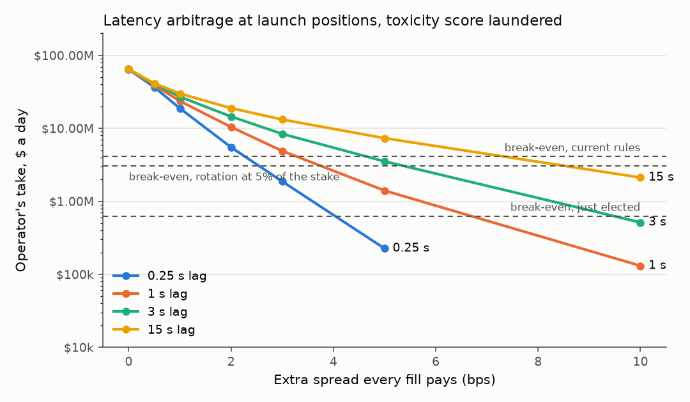
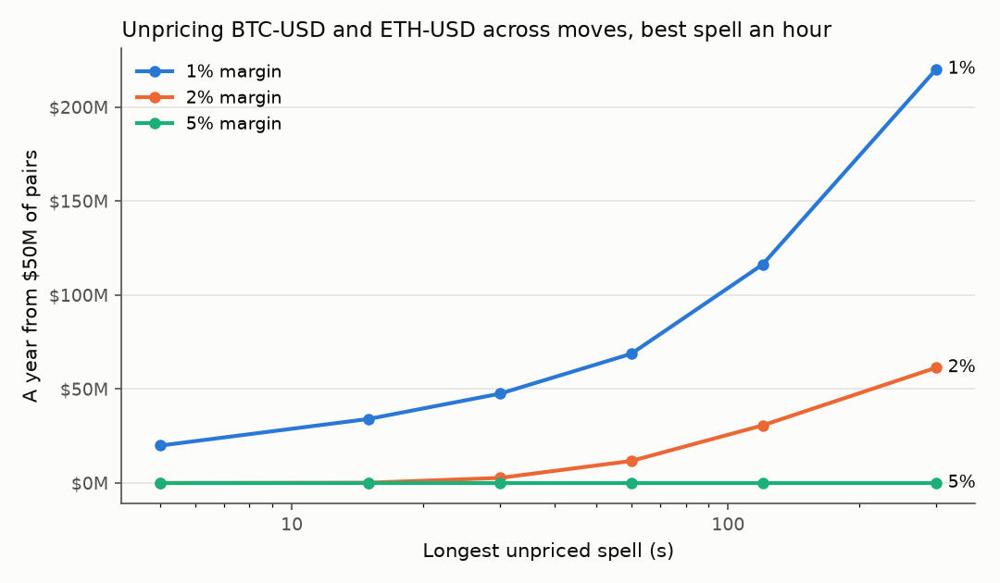

# Rogue operator

This study asks how much the operator can take while it keeps to every rule the enclave enforces,
and whether that is less than the operator puts at risk. The operator runs the trading server and
the machine that hosts its enclave. It can delay prices, hold the log's sync, reorder and censor
requests, and leave markets without a price. Under the rules the study modelled, extraction pays. On
BTC-USD, ETH-USD and SOL-USD, the operator's own accounts take $81.2M a day from the house by
trading against an engine price that runs up to 3 seconds behind the venues. All the crypto attacks
together give the operator $65.2M a day, against a share of distributions worth $169k a day at
launch flow. None of the attacks writes anything false to the public log. Only someone who compares
the log with the venues' own prices can see them.

The engine's launch rules differ from the rules modelled here in four ways. Every trade pays a
spread. A trade reversed at the same price within five seconds does not count towards the toxicity
score. The profit fee falls with holding time. Every market's stress level rises to 2 once the house
has lost money to its clients over the last 24 hours. Under those rules, the
[loss-rate trigger study](../loss-rate-trigger/README.md) finds that the operator's attacks together
take $289k a day, against an honest share of $386k, on its target client flow.

Rates are in basis points, abbreviated to bps. One basis point is one hundredth of one percent.

- [Results](#results)
- [Method](#method)
- [Data and sources](#data-and-sources)
- [Limits](#limits)
- [Re-running](#re-running)

## Results

[`results/report.md`](results/report.md) holds every table, and the figures below come from it or
from the CSV files beside it. A year's figure is a stratified estimate over the sampled hours, with
its 95% bootstrap interval in brackets. A day is a year divided by 365. Launch flow is the client
flow described under [Data and sources](#data-and-sources), and 10x is ten times that flow.

### What each attack takes

| Attack | Taken a day, launch flow | At 10x flow | Operator's take a day, launch | What limits it |
|---|---|---|---|---|
| Latency arbitrage, toxicity score laundered | $81.2M ($74.8M to $88.2M) | the same | $65.0M | the exposure cap alone |
| Latency arbitrage, if the toxicity add-on were paid | $10.5M ($9.1M to $12.1M) | the same | $8.4M | the 3 s lag and the add-on |
| Skimming client fills | $796k ($722k to $878k) | $5.94M ($5.41M to $6.52M) | $159k | the 3 s lag |
| Censoring requests to close for 10 s, against skimming them at arrival | -$18k (-$46k to $10k) | not measured | — | no momentum detected |
| Held sync's kill option, four restarts a day | $2k | the same | $2k | the 5 s alert |
| Unpricing across moves, $50M of pairs | $156k (-$3k to $431k); $35M on 2025-10-10 | the same | $125k | the 1% margin, but not the length of the unpriced spell |
| Altering Databento quotes, every index, commodity and share fill | up to $1.80M | up to $18.0M | $360k | the divergence bound |
| Choosing the venue, if `min_sources` were 1 | $806k | $8.06M | $161k | half the gap between the venues |
| All the crypto attacks together, score laundered | | | $65.2M ($60.0M to $71.1M) | |
| All the crypto attacks together, add-on paid | | | $8.7M ($7.4M to $10.2M) | |

Each row is a rate. The study takes the house to hold $107M, the liquidity floor that the
[cap calibration](../cap-calibration/README.md) recommends, so at the laundered rate the house is
empty in about a day and a half. Beyond that point, the operator's balances are claims on clients'
deposits in the vault. The combined rows add the operator's own latency arbitrage, held syncs and
pairs on the three crypto markets to its share of skimming every client fill there, all at once.

Attacks run through the operator's own accounts cost the house. Skimming, censoring and altered
quotes cost clients and pay the house, so the operator receives only its 20% share of what they
take. That share of distributions is worth $169k a day at launch flow, or $61.7M a year, and ten
times as much at 10x flow.

### Latency arbitrage

The price-age bound does not limit latency arbitrage when a trade pays no spread. In the rules the
study modelled, BTC-USD paid no spread on the first $2M of an account's position, and ETH-USD and
SOL-USD paid none on the first $1M. With no spread, every move the operator can see coming pays. Any
lead longer than the operator's decision interval therefore collects the index's whole variation. A
lag of a quarter of a second takes $80.4M a day, and the full 3 s lag takes $81.2M.

The toxicity add-on would price the operator's lead, but a laundered score never pays it. Only the
exposure cap then bounds the attack, through the utilisation trigger. At the launch caps the study
assumed, the operator holds $6.9M a market. At the cap calibration's retained NAV, the caps are
larger and the same attack takes $162M a day. The attack is not stealthy. It opens about
150,000 positions a day, and 84% of those on BTC-USD are winners.

At the launch positions of $6.9M a market, the operator's own accounts take from the house each day:

| Lag | No extra spread | +1 bp | +2 bps | +3 bps | +5 bps | +10 bps |
|---|---|---|---|---|---|---|
| 0.25 s, laundered | $80.4M | $23.5M | $6.9M | $2.3M | $282k | 0 |
| 1 s, laundered | $81.0M | $29.6M | $13.1M | $6.1M | $1.8M | $164k |
| 3 s, laundered | $81.2M | $33.9M | $18.2M | $10.5M | $4.4M | $643k |
| 15 s, laundered | $81.2M | $37.5M | $23.7M | $16.5M | $9.2M | $2.7M |
| 0.25 s, add-on paid | $2.3M | $856k | $282k | $158k | $9k | 0 |
| 1 s, add-on paid | $6.1M | $3.5M | $1.8M | $1.2M | $719k | 0 |
| 3 s, add-on paid | $10.5M | $6.6M | $4.4M | $2.8M | $1.5M | $95k |
| 15 s, add-on paid | $16.5M | $12.1M | $9.2M | $7.0M | $4.0M | $1.5M |

A zero in the table is a small negative estimate. The operator's policy chooses its trades without
the profit fee, so where almost nothing pays it can lose a little, and an operator would not trade.



With no spread, the length of the lag does not matter. The operator profits from every move it sees
before the engine does, and seeing one decision interval ahead is enough. Each basis point of spread
that every fill pays cuts the take sharply. The lag then decides how much is left, because only
moves larger than the cost of a round trip pay.

At a 3 s lag, with a laundered score and no extra spread:

- Deciding every 0.1 s instead of every 0.25 s takes 8% more, $88.0M a day. Deciding every 1 s takes
  20% less, $64.7M.
- Without the fast-move trigger's minimum spreads of 2 and 10 bps, the take is 4% higher, at $84.2M.
- At the cap calibration's retained NAV, the laundered take is $162M a day, and $19.5M with the
  add-on paid.
- BTC-USD takes $19.0M of the $81.2M, from 70,836 positions a day of which 84% win. ETH-USD takes
  $31.5M and SOL-USD $30.7M.
- On the live recording, the proxy for the index overstates BTC-USD's variation by about a third,
  and slightly understates SOL-USD's, as [The index against the proxy](#the-index-against-the-proxy)
  describes.

**Laundering the toxicity score.** In the engine the study modelled, the toxicity score was the
notional-weighted average of an account's markouts, which are the moves of the index after each of
its fills. A round trip at the zero spread tier, a buy and a sell of the same size at the same
index, paid no spread and no fee. It added two markouts that cancel, and its notional diluted the
score's history, so it pulled the score towards zero at no cost.

The engine test `crates/core/tests/rogue_operator.rs` shows the mechanism through `Engine::apply`.
An account that makes 10 bps on $500k in every cycle passes the first tier and pays the add-on
within 40 cycles. The same account, washing about $11M in each cycle, never pays it, and its washes
cost exactly nothing. Fresh accounts serve the same purpose. Each starts at the neutral prior, which
counts as $5.6M of history, and costs only a deposit. Request limits do not stop laundering: the
production template allows each account 10 requests a second, and the arbitrage decides four times a
second in each market, washes included, across as many accounts as it likes.

Under the engine's current toxicity score, a trade reversed at the same price within five seconds
does not count towards the score. The same engine test shows that the same round trips then leave
the score where they found it.

### Skimming and censoring

| Measure | Lag | Delay | bps of notional | A day, launch flow | A day, 10x |
|---|---|---|---|---|---|
| Sequenced (achievable) | 1 s | none | 0.19 (0.18 to 0.22) | $344k | $2.92M |
| Sequenced | 2 s | none | 0.34 (0.30 to 0.37) | $594k | $4.65M |
| Sequenced | 3 s | none | 0.45 (0.41 to 0.50) | $796k | $5.94M |
| Sequenced | 3 s | 1 s | 0.55 (0.50 to 0.60) | $973k | $7.01M |
| Each order alone (bound) | 3 s | none | 0.48 (0.44 to 0.53) | $856k | |
| Waiting out the delay (causal) | 3 s | 10 s | 0.46 (0.42 to 0.51) | $820k | |
| Waiting out the delay (causal) | 3 s | 30 s | 0.46 (0.39 to 0.54) | $811k | |
| Each order alone, with hindsight | 3 s | 30 s | 2.53 (2.33 to 2.76) | $4.48M | |

Skimming costs clients about half a basis point of every dollar they trade at a 3 s lag, which is
0.45 bps and $796k a day at launch flow. At a 1 s lag it takes about 40% of that. At ten times the
flow, orders crowd the index's path and each yields less, 0.34 bps, but the total still grows
sevenfold. The operator's 20% of skimming roughly doubles its honest income.

A monitor that rebuilds the index from venue data and compares each fill with it would catch
skimming nine times in ten, with false alarms on 0.1% of fills, within about 760 fills. That
estimate allows for an honest trading server's fills scattering half a basis point around the
reference. Without such a monitor, nothing shows the attack.

Delaying an order for longer than the lag shows no gain. An operator that holds each order for 10 or
30 s and then takes the worst index of its last 3 s gets no more than one that takes each order's
worst index at arrival. Both of those measures price each order on its own, so they compare with
each other and not with the sequenced rows. Only hindsight, which the operator does not have, would
gain from the longer window. The momentum measured after a fast minute agrees, within wide
intervals. Each cell is the mean move, in bps, in the direction of the trailing minute:

| A trailing minute that moved at least | Next 5 s | Next 30 s | Next 60 s | Next 5 min |
|---|---|---|---|---|
| 25 bps | 0.00 (-0.16 to 0.17) | 0.24 (-0.45 to 1.01) | 0.71 (-0.31 to 1.84) | 0.08 (-2.34 to 2.78) |
| 50 bps | 0.10 (-0.53 to 0.69) | 0.10 (-2.61 to 2.89) | 0.93 (-3.16 to 5.24) | 3.17 (-2.25 to 8.90) |
| 100 bps | 0.04 (-2.70 to 2.51) | 0.81 (-10.22 to 11.63) | -0.43 (-18.40 to 11.94) | -14.28 (-36.29 to 4.00) |

Every interval includes zero. The widest intervals span several bps either way, so a small edge is
not ruled out. Holding each request to close a position for 10 s, and then taking the worst index of
the last 3 s, takes $18k a day less (-$46k to $10k) than taking each such request's worst index at
arrival. Censoring a losing client's request to close, or a deposit that would have saved a
position, therefore gains the house nothing on average beyond the operator's 3 s view. A close-out
at the trigger is worth what the position was. A stop order that a held-back index gaps through is
executed like any other order, and skimming covers it.

### The held sync

The trading server writes each batch of commands to disk, the sync, before it answers any of them.
The operator can open a position at the stale index, hold the sync, and kill the trading server if
the trade lost, so that the trade never happened. A hold no longer than the lag never needs a kill,
because the window for closing the position still reaches back to when the trade opened in the
money.

At a 5 s hold, a kill is needed in 11% of uses and avoids a loss of 0.13 bps in each use, against
keeping the same trade. At a 30 s hold, which only a host without Secure TSC could sustain, the
figures are 34% and 1.08 bps. Four restarts a day on BTC-USD at $6.9M add about $2k a day, and every
restart is an outage that every client sees.

### Unpricing

Nothing bounds how long a market stays without a price, and no exposure cap limits a pair of
opposite positions. An operator holds pairs: long in one account and short the same notional in
another. It then holds one venue back across a fast move, so that the market has no price and
neither leg is closed out at its level. When the market is priced again, the losing leg's loss past
its 1% margin becomes the house's bad debt, while the winning leg keeps its gain.

Per year, from $50M a side of pairs on BTC-USD and ETH-USD:

| Rule | Longest spell | 1% margin (100x) | 2% (50x) | 5% (20x) |
|---|---|---|---|---|
| Causal, 40 bps in 5 s | 60 s | $26.7M (-$26.1M to $116.2M) | -$40.8M | -$45.1M |
| Causal, 40 bps in 5 s | 300 s | $57.0M (-$1.3M to $157.4M) | -$25.5M | -$30.9M |
| Best spell an hour, with hindsight | 60 s | $68.8M ($37.4M to $110.9M) | $11.7M | $0 |
| Best spell an hour, with hindsight | 300 s | $220.2M ($160.7M to $286.0M) | $61.4M | $0 |



The causal rule leaves the market without a price once the venues have moved 40 bps in 5 s, and
prices it again once the pair pays. Lower triggers fire on moves that never reach the margin, and
those spells lose the profit fee and the opening spreads. On 2025-10-10, the same rule on $50M of
pairs makes about $35M in four hours at 1% margin. At 2% margin, every causal rule tried loses money
over the year, and the best of them makes $0.3M on that day. SOL-USD, at 10% margin, never pays. A
spell long enough to pay is visible, because the log has no index for the market while both venues
quoted.

The causal figure is the study's least robust. Holding the index wherever the venues diverge, as the
engine would, moves it from $57M to $159M a year (-$9.8M to $482M), as
[The index against the proxy](#the-index-against-the-proxy) explains.

### Choosing the venue and altering quotes

If a market's `min_sources` were 1, the market would be priced from one fresh venue. The host could
then drop either venue's quotes and make the index the other venue's mid at any moment. On the live
recording, the venues' mids sit 0.44 bps (BTC), 0.48 bps (ETH) and 0.38 bps (SOL) from their
midpoint on average. Choosing the worse venue for each client therefore adds about 0.46 bps to every
crypto fill, which is $806k a day at launch flow, of which the operator receives $161k. While one
venue is held back, the divergence check is also off, so the index can follow a single venue
wherever that venue's own book is pushed. The cost of pushing a venue's book is not measured here.
On the other hand, a single fresh venue keeps a market priced, so unpricing would then need both
venues held back. The launch configuration sets `min_sources` to 2 in every market.

The study also measures a vendor whose quotes arrive without TLS, which the host could rewrite in
flight. Databento's gateway is such a source. On a market priced from such a source and one TLS
source, the index is the midpoint of the two. Keeping the two within 6 bps of each other, below the
level-1 divergence trigger of 7 bps on a 10 bps limit, moves the index up to 3 bps either way at
will. That is up to 3 bps on every index, commodity and share fill, or $1.80M a day at launch flow
if every one of those markets takes such a quote. The operator's own round trips would also gain
6 bps each with no lag at all, limited only by the caps, as latency arbitrage is. The launch
configuration reads every market-data vendor over TLS that ends inside the enclave, so it has no
such source.

### The index against the proxy

On the live recording, the engine's two-venue index moves less than the Coinbase trade proxy on
BTC-USD: 0.66 to 0.73 times as much over 0.25 to 8 s, and 0.68 times for the worst index of the last
3 s. It moves about as much on ETH-USD, at 0.85 to 0.97 times, and as much or more on SOL-USD, at
0.88 to 1.15 times, with 1.14 times its variation at 250 ms. The proxy therefore overstates
BTC-USD's figures by about a third, and leaves ETH-USD's and SOL-USD's within about 10% to 15%. If
the ratios were applied, the laundered latency take would move from $81.2M to about $78M a day.

During the recording, the venues never came within 10 bps of the 16 bps divergence trigger. In the
historical sample, measured by the venues' last trades, which overstate the divergence, the level-1
divergence trigger would have fired 2% of the time in the top 1% of hours and 29% of the time on
2025-10-10. On that day, the stress spreads the trigger brings would cut the operator's take below
what this study measures.

**Venue-specific moves.** Coinbase alone sometimes moves far from Kraken. On 2026-01-31 at 17:12
UTC, a sweep printed 4,286 Coinbase trades between $77,000 and $78,451 in four seconds, while
Kraken's lowest trade in those seconds was $78,082. Coinbase went 1.4% below Kraken, far past the
25 bps divergence limit, where the engine's index has no price.

Holding the proxy at its last value wherever Coinbase's last trade sits past the divergence limit
from Kraken's changes the results as follows:

- The laundered latency take falls by 0.3%, the take with the add-on paid by 1.3%, and skimming by
  0.6%.
- The hindsight unpricing figures fall by 17% to 29%, to $48.8M a year for 60 s spells and $182.5M
  for 300 s spells.
- The causal unpricing figure rises from $57.0M to $158.7M a year. An index held through a
  divergence and then released jumps, and the causal rule collects those jumps. Kraken's last trade
  lags its book, so the held version also holds the index through some genuine fast moves.

The two treatments therefore bracket the causal unpricing figure between $57M and $159M a year
(`results/report.md`, "Venue-specific moves held out").

### What the operator risks

| Removal | Operating days | Seat (one year of its share) | Break-even take per operating day, launch | At 10x |
|---|---|---|---|---|
| Election, past the minimum term | 15 | $61.7M | $4.11M | $41.1M |
| Election, inside the 90-day minimum term | 98 | $61.7M | $630k | $6.30M |
| Timelock installs a fallback | 3 | $61.7M | $20.6M | $206M |
| Guardian retires the signer within 6 hours | 0.25 | $61.7M | $247M | $2.47B |
| Daily rotation, one day, 1% of the stake | 1 | $617k | $617k | $6.17M |
| Daily rotation, one day, 5% of the stake | 1 | $3.08M | $3.08M | $30.8M |
| Daily rotation, one day, 25% of the stake | 1 | $15.4M | $15.4M | $154M |

The seat is one year of the operator's share of distributions, which removal forfeits. The
break-even is the seat divided by the days the operator still operates after stakers act. An attack
pays when its take per operating day exceeds the break-even. The figure is the best case for the
defence, because it assumes that someone sees the attack on the day it starts.

Removal comes too late to stop an attack that ends in an exit:

- If stakers act on the day an attack starts, an operator past its minimum term keeps operating for
  about 15 days, so any attack taking more than $4.1M per operating day pays. Inside the 90-day
  minimum term, the threshold is $630k.
- Under daily rotation, a member with 5% of the stake has a seat worth $3.1M a year and a whole day
  to itself, so one day of anything over $3.1M pays. Daily rotation shortens how long one operator
  runs, but it hands every member of the rotation set a whole day, and a small member has little
  seat to lose.
- Only the guardian, which can retire the signer at once, stops an exit within hours. At six hours,
  the break-even is $247M a day. The cost is that every client's commands stop, which the study
  counts as three days until a standby takes over.

Stakers receive 80% of what skimming and altered quotes take from clients, so their incentive to act
on those attacks is weaker than on attacks that cost the house. The self-bond is never slashed. It
adds a loss only through MONKEY's price, and at 0.1% of MONKEY's maximum supply it is worth what the
market says.

### Where extraction stops paying

Each row compares the take of an attack, per operating day, with the break-even of each removal
route, and asks whether the production values the study read meet it.

| Attack | Stops paying when | Values the study read | Met |
|---|---|---|---|
| Latency arbitrage | The operator's take per operating day is below the route's break-even. Against an election past the minimum term ($4.1M), either the add-on is paid with a lag of at most 1 s and 1 bp of extra spread ($2.8M), or a laundered score faces 5 bps of extra spread at a 3 s lag ($3.5M). Inside the minimum term ($630k), or for a rotation member with 1% of the stake ($617k), it needs a lag of at most 0.5 s with the add-on and 3 bps more | laundered score, no spread, 3 s lag | no |
| Unpricing pairs | Margin of 2% or more on BTC-USD and ETH-USD, so that a pair needs a 2.2% move inside one spell | 1% to $2M | no |
| Skimming, altered quotes | A monitor detects them. Their take is below every break-even if stakers act at once, and pays indefinitely if nobody acts | no monitor | no |
| Held sync, censoring | Already below every break-even | 5 s; requests expire after 5 minutes | yes |

### Proposals

The study proposes seven changes. Each is listed with its status in the launch configuration.

1. **Watch the log against the venues.** Every attack here except the held sync leaves a statistical
   trace in public data. The traces are an index that runs behind the venues' timestamps, fills at
   the worst index of the last few seconds, accounts whose fills win against the next seconds' venue
   price, round trips that make nothing, and markets left without a price while their venues quote.
   A monitor that publishes these, and that each incoming member runs as its check under daily
   rotation, turns skimming and altered quotes from attacks that pay indefinitely into attacks that
   pay until someone acts. Status: proposed.
2. **Make the toxicity score cost something to dilute.** The options are to score markouts over time
   rather than notional, to leave out fills that open and close at the same index, or to charge
   every fill a minimum spread. Fresh accounts still reset the score, so the score bounds latency
   arbitrage only as far as new accounts are slow or costly to fund. Status: in the engine. A trade
   reversed at the same price within five seconds does not count towards the score, and every
   market's first spread band is above zero.
3. **Bound the house's loss rate.** No rule in the engine the study modelled limits how fast latency
   arbitrage drains the house at a zero spread. A stress trigger on the house's loss to clients over
   a window, raising markets to the level-2 spread, would cap the take whatever the score does. At
   10 bps the laundered take at a 3 s lag is $643k a day. Status: in the engine, as the
   [loss-rate trigger study](../loss-rate-trigger/README.md) calibrates it. Every market rises to
   level 2 once the house has lost money to its clients over the last 24 hours.
4. **Raise the margin on positions that can be paired, or bound how long a market stays unpriced.**
   At 2% margin (50x) on BTC-USD and ETH-USD, every causal rule tried loses money over the year, and
   the best of them makes $0.3M on 2025-10-10. At 1% they pay. Status: not adopted. BTC-USD and
   ETH-USD launch at 1% margin on the first $2M of a position, with the house loss trigger as the
   bound on paired positions.
5. **Shorten the lag.** Reducing `feeds.venues.max_delay` from 2 s to 1 s, which gives a 2 s lag,
   cuts skimming by a quarter, to 0.34 bps from 0.45. The cost is more unpriced time when a venue's
   stream is slow. A six-hour recording of the venues put the rule's own unpriced time, away from
   local stalls, at 0.26% of the time with a bound of 1.25 s, against 0.14% at 2 s. Shortening the
   lag does nothing for latency arbitrage at a zero spread. Status: not adopted. The production
   template keeps `max_delay` at 2 s.
6. **Size rotation membership to one day of capacity.** Under daily rotation, a member's share of
   the stake times a year of the operator's income, or a bond forfeited on proven abuse, should
   exceed what one day of the remaining attacks takes. Status: proposed.
7. **Authenticate every quote source,** or count only TLS sources towards `min_sources`. Status: in
   the launch configuration, which reads every market-data vendor over TLS that ends inside the
   enclave.

## Method

### The attacker

The attacker is the operator in effect. It runs the host, holds the admin key, and trades through
any number of accounts that the engine cannot link to it. It is rational: it attacks when the
expected gain exceeds what it expects to lose.

The operator cannot change the engine's rules, have the enclave sign a state the rules do not
produce, or act for an account without its key. The host does, however, carry every byte into and
out of the enclave, set the wall clock within a bound, own the disk, and stall or restart the
process. Within the bounds the image enforces, the operator controls the following:

- **The network.** TLS stops it reading or altering venue frames, client requests and replies, but
  not delaying or dropping them. TLS ends inside the enclave, so for a client request the operator
  sees the timing, size and source of the encrypted bytes, but not their content.
- **The disk.** The operator reads each command as the sequencer writes it to the public log, before
  the batch is durable and before any reply or stream entry goes out.
- **The clock,** within `time.max_drift` of signed Roughtime readings.
- **The process.** The operator can stall the sync or the CPU, and kill the trading server and
  restart it from the host's disk.

None of these actions writes anything false to the public log. No successor, standby or vault check
can therefore prove that they happened, and what they gain arrives as ordinary trades.

The engine, as built, bounds each lever as follows, at production values, with Secure TSC on:

| Lever | Bound | Where |
|---|---|---|
| Price lag | A fill's price is at most `max_delay + max_age_ms` = 2 s + 1 s = 3 s old, measured from the venue's send | `crates/node/src/feeds/venue/delay.rs` |
| Quiet venue | A stalled book's leg holds at most 5 s more while its pings answer. The host cannot fake a stall, since a pong arrives only behind every frame sent before it | `crates/node/src/feeds/venue/standing.rs` |
| Held sync | A Critical alert, and stamping stops, once the oldest unsynced batch is held past 5 s | `crates/node/src/sequencer/pipeline.rs` |
| Request delay | A client request's own expiry, at most 5 minutes ahead (`MAX_EXPIRY_AHEAD_MS`) | `crates/core/src/auth.rs` |
| Unpriced spell | None. A market whose venue is held back past `max_delay` has no price | |
| Altered quotes, as in the [Databento attack](#choosing-the-venue-and-altering-quotes) | Closed. Only a venue reached over TLS that ends in the enclave sets a price, so the host can delay or drop its quotes but not alter them | `crates/node/src/feeds/venue/` |
| Rolling back the log | Detected and provable, through the on-chain log heads and the standby's signed copy | `contracts/src/LogHeads.sol`, `crates/node/src/standby/` |

The engine's own defences, as the study read them from `config/production-genesis.toml`, were:

- a spread made of the stress level's minimum (0, 2 or 10 bps), the account's toxicity add-on (2 bps
  from a score of 1 bp, 3 bps from 2 bps), and a size spread on the part of an account's position
  past the first tier, whose first tier on BTC-USD was 0 bps up to $2M;
- the closing spread caps, and a profit fee of 10% on realised gains;
- the house's exposure caps, which refuse an order that would grow the house's net exposure past
  them, and the utilisation trigger at 70% of a cap;
- the divergence limit, and the stress triggers on fast moves (75 and 200 bps in a minute), on
  divergence (60.01% and 95% of the divergence limit) and on utilisation (70% and 95%).

The defences outside the engine were:

- removal by election, with 14-day epochs, a 90-day minimum term, and 7 days' notice plus a 1-day
  finality margin, or by daily rotation;
- the operator's 20% of distributions, which removal ends;
- the self-bond, 0.1% of MONKEY's maximum supply, locked but never slashed;
- the guardian, which can pause withdrawals and retire the signer at once;
- the timelock, with a 3-day delay.

Every time bound above rests on the guest's monotonic clock. Without Secure TSC, a host that scales
that clock stretches all of them, so the price lag and the held sync have no bound. The sweeps below
run the lag to 15 s and the hold to 30 s to show what that is worth.

### The attacks

| Attack | What the operator does | Who pays | What limits it | What does not |
|---|---|---|---|---|
| Latency arbitrage | Trades its own accounts against the index it holds up to 3 s behind the venues | The house | The exposure cap, through the utilisation trigger; the fast-move trigger's 2 bps; the toxicity add-on, if the account pays it; the profit fee | The lag bound. At a zero spread, any lead longer than the operator's decision interval collects the index's whole variation. Round trips at the zero tier cost nothing and pull the toxicity score back down, so the add-on is never paid |
| Front-running by reordering | Puts its own orders ahead of others' | — | Requests are encrypted to the enclave, so the host sees only timing and size. Fills are at the index, so no client order moves the price. Size spreads read each account's own position | Room under the cap goes to whoever comes first. An order the operator puts first can take the room a client needed, and push a market over the utilisation trigger so that the client pays 2 bps |
| Skimming | Fills each client order at the worst index of the last 3 s, through reordering and the lag | Clients, to the house | The lag | Each fill looks like latency, and only the aggregate shows |
| Free option on a held sync | Trades, holds the sync for up to 5 s, and kills the trading server if the trade lost | The house | The 5 s alert. Every client sees replies stall, and each kill is a restart | Nothing records a kill in the log |
| Censoring requests to close, stop orders and deposits | Delays other accounts' requests to close and their deposits while the market moves against them, and gaps the index through their stops | Clients, to the house | The lag, beyond which a delay is a bet; the request's expiry; the latency every client sees | — |
| Unpricing | Holds one venue back past `max_delay` across a fast move, so that its paired positions skip their close-out | The house, as bad debt | The margin, since a pair pays only past a move of about `margin / 0.9`, 1.1% at 100x; the profit fee | How long a market stays unpriced; the caps, since a pair adds no net exposure |
| Choosing the venue (`min_sources = 1`) | Holds one venue back, so that the index is the other venue's | Clients, to the house | Half the gap between the venues | The divergence check, which needs two sources |
| Altering quotes without TLS | Moves the index within the divergence limit, on markets priced from such a source and one TLS source | Clients or the house | `max_divergence_bps`, and the level-1 divergence trigger | — |
| Rolling back the log | Cuts answered commands from the log | — | Provable through the on-chain log heads and the standby | Out of scope, because it leaves signed evidence |

### The models

Every attack runs on every sampled hour (`model/hourly.py`), in one of three units: per dollar of
the operator's own position, per dollar a side of its paired positions, or in dollars at the
modelled client flow. `run.py simulate` spreads the hours over three workers. It is deterministic,
because each hour's client arrivals are seeded by the hour.

**Latency arbitrage** (`model/latency.py`). Holding the index `lag` seconds behind the venues means
that the operator always knows the engine's next `lag` seconds of index. Every 250 ms, it chooses a
position of `-1`, `0` or `+1` units by a receding-horizon dynamic programme over the index it knows,
given the spread each fill pays. That spread is the stress level's minimum from the fast-move
trigger, replayed on the hour (`model/stress.py`), plus any extra spread in the sweep, plus 3 bps if
the account pays the top toxicity tier. Each position then pays the profit fee on a positive result.
The position is 69% of the market's cap, so the utilisation trigger at 70% never fires. That is
$6.9M a market at launch, under the $10M floor that the cap calibration recommended, and $22.2M,
$14.8M and $7.4M at its retained NAV. One account per $2M keeps every fill in BTC-USD's zero size
tier.

**Skimming and censoring** (`model/skim.py`). Client fills arrive as a Poisson process at the flow
rate, each a buy or a sell with even odds, with a size from the flow model. An order arriving at
time `a` can fill at the index of any moment from `a - lag` to `a + delay`, and the operator picks
the worst moment for the client. Three measures give the house's gain against the index at arrival:

- `bound` gives every order its own worst moment. It is an upper bound, since one index path serves
  every order.
- `sequenced` fills orders in arrival order on an index that only moves forward, by an exact dynamic
  programme over the moments. It is achievable, and reordering clients could do better.
- `causal` applies to a delay longer than the lag. The operator waits the whole delay and takes the
  worst index of the last `lag` seconds, since it cannot know the window's worst moment until the
  window has passed.

**The held sync** (`model/hold.py`). Every 10 s, the operator opens a position at the stale index in
the direction the venues have already moved, then holds the sync for `hold` seconds. If the best
close it can then show loses, it kills the trading server and the trade never happened. Otherwise it
commits. The kill option's value is the loss it avoids against keeping the same trade. The report
also gives the result of closing at once, without the hold.

**Unpricing** (`model/unprice.py`). The operator holds pairs at the margin floor. Per dollar a side,
a repricing after a move `J` pays `0.9 (J - s) - min(J + s, m)`, where `m` is the margin rate and
`s` is the stress minimum that closing both legs pays once the move reads as fast.
`crates/core/tests/rogue_operator.rs` checks this through `Engine::apply` with no stress spread
(`s = 0`), on the protocol V21 harness, the latest without access screening. The study runs two
rules:

- `best` takes the hour's single best spell of at most `spell` seconds, chosen with hindsight.
- `causal` unprices once the venues have moved `trigger` bps in 5 s, and counts the move from the
  engine's last index 3 s earlier. It prices the market again as soon as the pair pays 0.3% past
  break-even, or at the end of the spell.

The pairs are $50M a side, which is $1M of margin a side at 1%.

**Momentum** (`model/hourly.py`). Delaying a request for longer than the lag pays only if moves
continue. For each second whose trailing minute moved at least 25, 50 or 100 bps, the study records
the move over the next 5, 30, 60 and 300 s in the same direction.

**A year's estimate** (`model/stats.py`). A measure's total for the year is the sum over strata of
each stratum's hours times its mean, scaled from 8,755 to 8,760 hours. Its 95% interval is a
stratified bootstrap of the hours, with 10,000 draws. A rate per fill is a ratio of two totals for
the year, bootstrapped together.

**What the operator risks** (`model/economics.py`). An attack on the house through the operator's
own accounts costs the operator its share of what it takes. It keeps `0.8 (1 - stake)`, where
`stake` is its share of staked MONKEY, taken as 0 here. An attack on clients pays the house, of
which the operator receives `0.2 + 0.8 stake`. Removal is measured in the days the operator keeps
operating once stakers act:

- under the election rules, the next election's close, 7 days away on average, plus the 8 days of
  notice and finality margin, or up to 98 days for an operator still inside its 90-day minimum term;
- under daily rotation, the remaining day, at the operator's share of the days;
- through the timelock, 3 days.

Removal forfeits the seat, the operator's future share, which the study values at one year of it.
The self-bond is never slashed, so it enters only through what MONKEY's price loses.

## Data and sources

**A year of venue trades, sampled by volatility.** The three markets measured are BTC-USD, ETH-USD
and SOL-USD, which carry 77% of launch flow and are priced from Coinbase and Kraken.
`fetch/history.py candles` pulls Coinbase Exchange's hourly candles for each market from
2025-11-01 to 2026-11-01. They cover 8,755 of the year's 8,760 hours, and Coinbase has no candles
for the other five. `derive/sample.py` ranks each market's hours by their Parkinson volatility,
`ln(high / low) / sqrt(4 ln 2)`. It splits them into five strata, the quietest 50% and then 50% to
80%, 80% to 95%, 95% to 99% and the top 1%, and draws 10, 10, 10, 10 and 12 hours from them at seed
549. That gives 52 hours a market, with the busiest hours sampled 40 times as densely as the
     quietest.

`fetch/history.py trades` then pulls every Coinbase Exchange trade in each sampled hour, from three
minutes before it to two minutes after, paging back by trade id, and every Kraken trade, paging
forward by time. Both are public endpoints that need no key. The pull checks each trade for a
positive, finite price and size and a time inside the window, and each page for ordered ids or
times. It retries or stops rather than write a partial hour.

**A stress day.** 2025-10-10, the largest crypto liquidation day on record, falls a month before the
year. Its four most volatile hours on each market are pulled the same way and reported apart. They
never enter a year's estimate.

**The index proxy.** The engine prices these markets from the midpoint of Coinbase's and Kraken's
book mids. Public history has trades, not books, so the model's index is Coinbase's last trade on a
50 ms grid (`derive/grids.py`). Coinbase prints several trades a second on these pairs, and its
spread is a cent. Kraken trades a tenth as often, so its last trade lags its book, and the Kraken
grid is kept only for checks. `derive/grids.py` stores the grids delta-encoded in
`data/derived/grids.npz` (3 MB). `grids.json` records each hour's trade count, its longest gap
between trades, and the SHA-256 of the raw file it came from.

**A live recording.** To see how far the proxy is from the engine's real index,
`fetch/record_books.py` recorded both venues' top of book and trades on the three pairs on
2026-11-04, one whole UTC hour in all. It used Coinbase's `level2` and `market_trades` channels and
Kraken's `book` at depth 10 and `trade`, as the trading server's adapters subscribe.
`derive/calibrate.py` compares the two-venue book-mid index with the Coinbase trade proxy over each
whole hour: their moves over each horizon, their variation at 250 ms, the worst index a 3 s
look-back offers, the half-gap between the venues, and the share of time the venues diverge past the
divergence triggers (`results/calibration.json`).

**Client flow.** The flow is the one the [cap calibration](../cap-calibration/README.md) models
(`model/flow.py`): a steady $182M of margin opened a day, each market's share of that study's market
mix, each position at the market's maximum leverage under its margin bands, and the fill sizes of
that study's size profile. At launch flow this is $12.0B of BTC-USD fills a day, 1.5 a second at
$90k on average, $5.4B of ETH-USD and $0.18B of SOL-USD. The 10x flow multiplies the margin by ten.

**The house's honest income.** The cap calibration's baseline at its recommended $107M liquidity
floor, under the crypto margin bands it planned, distributes a mean of $76.1M over 90 days at launch
flow. That is $845k a day, so the operator's 20% is $169k a day, or $61.7M a year. The study scales
the income tenfold at 10x flow. The cap calibration's own flow sensitivities move only the markets
it clones, so they cannot test that scaling.

## Limits

- **The engine's rules differ from those the study modelled.** Every launch market's first spread
  band is above zero, so a round trip costs money. A trade reversed at the same price within five
  seconds does not count towards the toxicity score. The profit fee falls from 100% within 10 s to
  the tier's base rate at 15 minutes. Every market rises to stress level 2 once the house has lost
  money to its clients over the last 24 hours. Level 1's utilisation trigger fires at 80% of a cap,
  not 70%, and each launch market's cap floor differs from the $10M floor the study assumed. The
  headline latency figures therefore measure rules the engine does not have. The
  [spread calibration](../spread-calibration/README.md) and the
  [loss-rate trigger study](../loss-rate-trigger/README.md) measure the same attacks under the
  launch rules.
- **The liquidity floor differs.** The study takes the house to hold the cap calibration's $107M.
  The launch deployment's liquidity floor for distributions is $30.5M.
- **The index is a proxy.** Coinbase's last trade stands in for the two-venue book-mid index. The
  live recording measures the gap between them over one whole UTC hour. Its ratios are reported, not
  applied, and a busy window may differ.
- **Three markets of the 37 the flow model covers.** BTC-USD, ETH-USD and SOL-USD carry 77% of
  launch flow. No public tick data covers the vendors that price the rest. The figure for quotes
  altered in flight is a bound, not a simulation, and the launch configuration has no source without
  TLS.
- **The flow is a model.** The cap calibration's flow comes from ten days of one venue's launch, at
  higher leverage than these markets allow. Skimming and censoring scale with the flow, while the
  operator's own attacks do not. Ten times the flow assumes that the house's income scales with it.
- **A year of 52 hours a market.** The top stratum's spread dominates every interval. The bootstrap
  intervals are approximate at ten or twelve hours a stratum, and the stress day shows what a year
  without such a day misses.
- **The operator's best response is approximated.** Latency arbitrage decides on a 250 ms grid, and
  a 10 ms grid would take more. Skimming keeps clients in arrival order, and reordering them would
  take more. The unpricing rule is one simple trigger. Each strategy is achievable, so against the
  same index the operator could take at least what is measured. The proxy's error cuts both ways.
- **The engine is simplified.** The model leaves out the divergence trigger and, except in the
  sensitivity above, the divergence limit. The historical sample has no Kraken book, and on the live
  recording the venues never came near either. The model also leaves out the size spread past the
  first tier, financing and rounding. The two mechanisms the conclusions rest on, laundering a
  toxicity score and a pair across an unpriced jump, are checked through `Engine::apply`.
- **The operator's position ignores clients'.** Clients' net exposure shares the cap with the
  operator's. The operator's 69% assumes that clients net to zero.
- **Removal is modelled with the study's parameters.** The election's epoch, minimum term and notice
  are the values the study read, and the guardian route counts three days of stopped commands until
  a standby takes over.
- **Detection is not modelled as a probability.** Whether someone watches the log against venue
  prices, and how fast stakers act, are choices, not data. The break-even figures assume that
  stakers act on the day an attack starts, the best case for the defence. An attack that nobody
  detects pays at any rate.

## Re-running

From a virtualenv outside the repository (Python 3.12 or newer), in this directory:

```sh
python3 -m venv /tmp/rogue-venv && /tmp/rogue-venv/bin/pip install -r requirements.txt
/tmp/rogue-venv/bin/python -I -m pytest tests          # the models on hand cases
/tmp/rogue-venv/bin/python -I run.py all --workers 3   # every attack, then results/
cargo test -p engine-core --test rogue_operator --locked   # the engine mechanisms, from the repo root
```

`run.py all` reads only the committed `data/derived/` and `results/calibration.json`, and needs no
network. It takes about five minutes on three workers, and a second run writes the same files.

To rebuild the data, which public endpoints serve to anyone:

```sh
python -I fetch/history.py candles data/raw
python -I derive/sample.py data/raw data/derived/sample.json
python -I fetch/history.py trades data/raw data/derived/sample.json   # resumes; about two hours
python -I derive/grids.py data/raw data/derived/sample.json data/derived/grids.npz
python -I fetch/record_books.py data/raw/live 25200                    # seven hours of books
python -I derive/calibrate.py data/raw/live results/calibration.json
```

A rebuilt sample draws the same hours, at seed 549, from the same candles. `grids.json` records the
SHA-256 of every raw file, so a rebuild can be checked trade for trade. The live recording covers a
new window each time it runs. Raw data goes to `data/raw/`, which is gitignored. The models are in
[`model/`](model), their tests in [`tests/`](tests), and every result in [`results/`](results).
